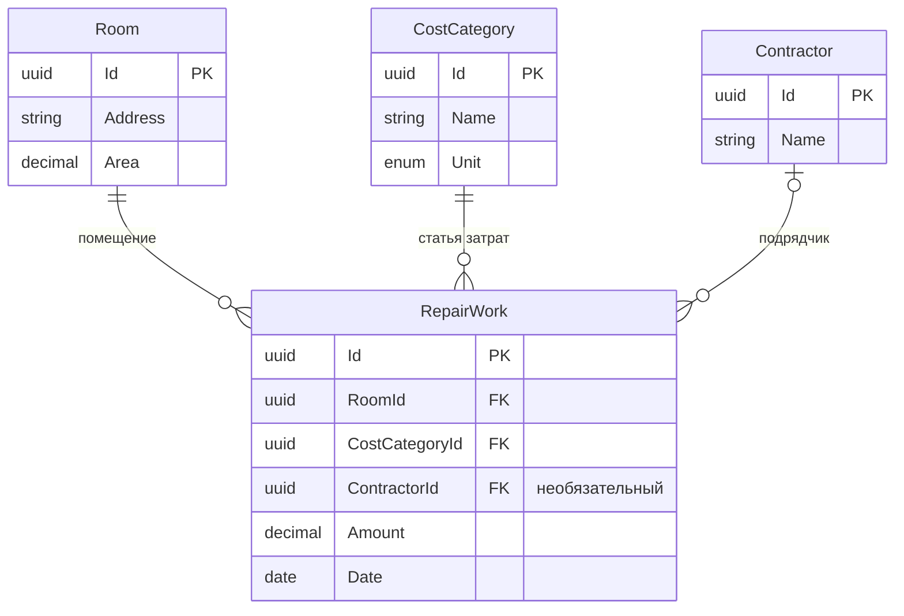

# ОТП. Лабораторная работа № 1, вариант № 1

Приложение «Учёт стоимости ремонтных работ» на C# и Windows Forms.

## Запуск

На Windows с .NET 10 SDK открой `RepairCosts.slnx` в Visual Studio и нажми F5. Из терминала в папке решения можно выполнить:

```powershell
dotnet run --project .\RepairCosts\RepairCosts.csproj
```

Репозитории-заглушки хранят записи в памяти до закрытия приложения. Для демонстрации сначала добавь помещение и статью затрат. Подрядчика добавь, если хочешь показать оба способа выполнения работ. Затем открой «Операции → Ремонтные работы» и внеси запись.

## ER-диаграмма



Между помещениями и статьями затрат связь «многие ко многим». Сущность `RepairWork` хранит эту связь и данные самой операции. У каждой работы свой идентификатор, поэтому можно зарегистрировать несколько работ с одной парой «помещение — статья». На диаграмме показаны внешние ключи, а в моделях C# им соответствуют ссылки на объекты. Подрядчик выделен в третий справочник. Вариант «Своими силами» сохраняется как `null` в поле `Contractor`.

## Что показать на защите

1. Открой меню «Справочники», затем каждый список и форму добавления. Нажми «Сохранить» с пустыми полями, чтобы показать сообщение проверки. Добавь запись, открой её на редактирование и покажи удаление записи, которая ещё не использована в работах.
2. В «Операции → Ремонтные работы» открой добавление, покажи проверку пустого помещения и суммы. Добавь две работы с одной и той же парой «помещение — статья». Для одной выбери подрядчика, для другой оставь «Своими силами».
3. Открой `Program.cs`. В `Bootstrapper.BuildContainer()` интерфейс, например `IRoomRepository`, связывается с `RoomRepositoryStub`. Контейнер читает параметры конструктора формы и подставляет зарегистрированные реализации. Репозитории зарегистрированы как singleton, поэтому формы работают с одними и теми же записями.
4. В `Models.cs` перечисление `MeasurementUnit` задаёт одну единицу измерения. Флаговое `EstimateDimensions` позволяет объединить несколько разрезов выражением `Room | CostCategory`. Отдельные флаги имеют значения 1, 2 и 4, поэтому занимают разные биты. Перечисление задано для будущих отчётов.
5. В `RepairWorkListForm` каждая строка `DataGridView` соответствует одной операции. Форма берёт записи из репозитория и выводит дату, адрес, статью, подрядчика и сумму. После успешного добавления она перечитывает записи.

## Сдача через Git

Перенеси исходники в ветку от `main` существующего репозитория. Если в нём уже настроен `.gitignore`, объедини правила. Открой pull request в `main` с названием «Группа ФИО Лабораторная работа 1». Перед отправкой проверь, что в PR вошли только файлы лабораторной и в нём отсутствуют результаты компиляции.
